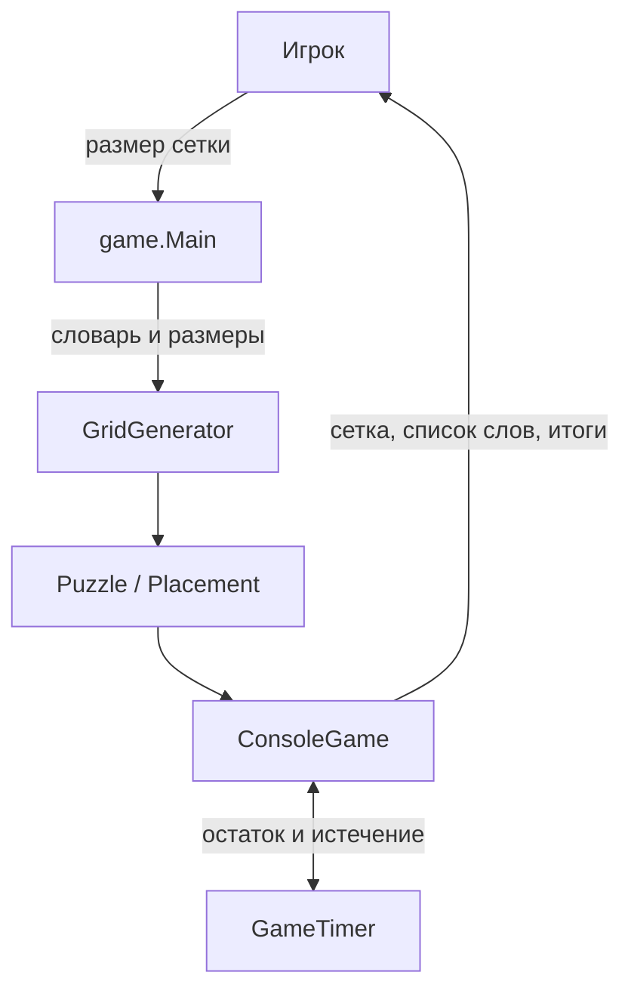
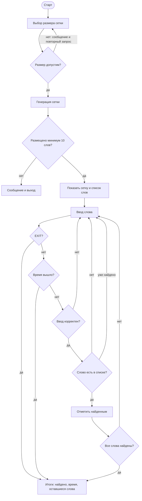
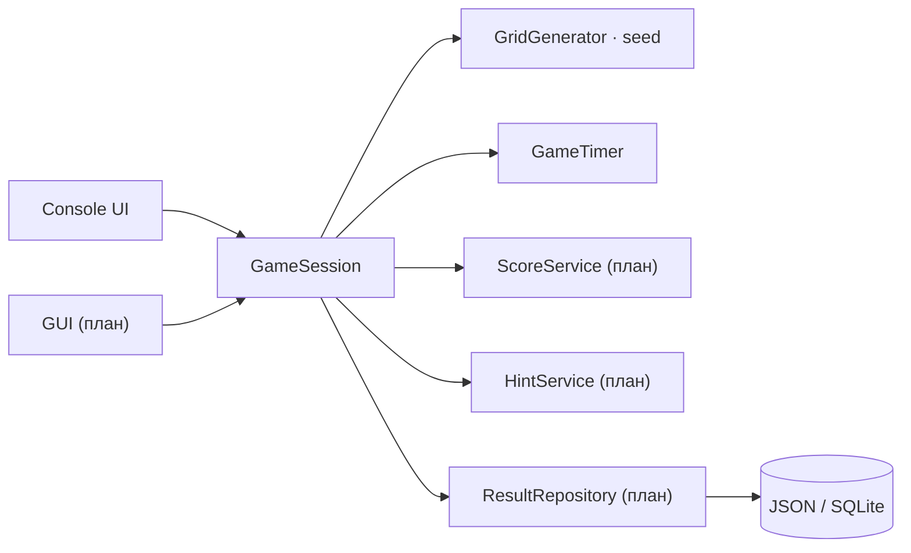

# zaeso-Words — актуальная карта проекта

Карта фиксирует фактическое состояние `main` и только незавершённый backlog.
Завершённые работы перечислены кратко и не дублируются среди активных задач.

**Последняя сверка:** 3 ноября 2026 года. `main` находится на `c6b7171`,
версия в `pom.xml` — `1.0-SNAPSHOT`, тегов и релизов пока нет. Локальная
проверка `mvn verify` проходит: 25/25 тестов, сборка JAR успешна. CI настроен
на GitHub Actions и запускается при push в `main` и при создании pull request.

**Статусы:** 🔴 следующий приоритет; 🟡 после него; ⚪ позднее или после
внешней подготовки; ✅ готово. Следующий приоритет — верхний 🔴.

## Снимок текущего состояния

| Показатель | Значение |
| --- | --- |
| Платформа | Java 17+, консоль |
| Сборка | Maven, `maven-compiler-plugin` 3.13.0 |
| Тесты | JUnit 5, 25 тестов, Surefire 3.5.2 |
| CI | GitHub Actions, Temurin JDK 17, `mvn verify` |
| Генерация | 10×10, 11×10, 10×11, 12×10, 10×12 |
| Игровой режим | Ввод слов в консоли, 5 минут по умолчанию |
| Сохранения | Нет |
| GUI | Нет |
| Релизы | Нет, только `1.0-SNAPSHOT` |

## Что уже сделано

| Дата | Коммит | Автор | За что отвечает |
| --- | --- | --- | --- |
| 2026-11-02 | [`fc8bfbf`](https://github.com/zaeso/zaeso-Words/commit/fc8bfbf) | zaeso | Начальный коммит: создание репозитория и базового README. |
| 2026-11-03 | [`52b47ae`](https://github.com/zaeso/zaeso-Words/commit/52b47ae) | zaeso | Базовая структура Java-проекта: модель, генератор сетки и консольный игровой режим. |
| 2026-11-03 | [`9e5c497`](https://github.com/zaeso/zaeso-Words/commit/9e5c497) | zaeso | Обновление файла дорожной карты проекта. |
| 2026-11-03 | [`8623f53`](https://github.com/zaeso/zaeso-Words/commit/8623f53) | zaeso | Таймер игры: `GameTimer`, обратный отсчёт, предупреждения, завершение по времени и вывод затраченного времени. |
| 2026-11-03 | [`4e4a9b8`](https://github.com/zaeso/zaeso-Words/commit/4e4a9b8) | zaeso | Первые тесты JUnit 5, Maven-сборка, CI GitHub Actions, `.gitignore` и раздел тестирования в README. |
| 2026-11-03 | [`8f7992e`](https://github.com/zaeso/zaeso-Words/commit/8f7992e) | zaeso | Обновление GitHub Actions: `checkout@v5`, `setup-java@v5`, runner `ubuntu-24.04`. |
| 2026-11-03 | [`945a298`](https://github.com/zaeso/zaeso-Words/commit/945a298) | zaeso | Добавление таблицы истории коммитов в дорожную карту. |
| 2026-11-03 | [`c6b7171`](https://github.com/zaeso/zaeso-Words/commit/c6b7171) | zaeso | Очистка дорожной карты от Python-обёртки, приведение файла к чистому Markdown. |

### Ключевые результаты

- ✅ Реализована генерация буквенной сетки.
- ✅ Слова размещаются в 8 направлениях и могут пересекаться на одинаковых буквах.
- ✅ Пустые клетки заполняются случайными буквами.
- ✅ Работает консольный игровой цикл с проверкой слов и защитой от повторов.
- ✅ Добавлен таймер с предупреждениями и завершением игры по истечении времени.
- ✅ Добавлены первые тесты JUnit 5 и CI.
- ✅ Настроены Maven и GitHub Actions.
- ✅ README содержит запуск, описание алгоритма, таймера и тестирования.
- ✅ Некорректный ввод обрабатывается без выхода из игры: размер запрашивается
  заново, пустые, латинские и слишком длинные слова отклоняются с пояснением.

## Рабочие возможности

- Игрок выбирает допустимый размер сетки: 10×10, 11×10, 10×11, 12×10 или 10×12.
- Генератор нормализует словарь: верхний регистр, удаление посторонних
  символов, дедупликация и отсев слов, которые не помещаются в сетку.
- Длинные слова размещаются раньше коротких, чтобы уменьшить число неудачных
  раскладок.
- Сетка заполняется полностью: пустые клетки получают случайные русские буквы.
- Игрок вводит слово целиком; регистр не важен, повторно найденное слово
  отклоняется.
- Некорректный размер сетки запрашивается заново. Пустой ввод, слова с
  латиницей или другими символами и слишком длинные слова отклоняются с
  пояснением, игра продолжается.
- `EXIT` принимается в любом регистре.
- На игру отводится 5 минут. Оставшееся время показывается в приглашении,
  предупреждения выводятся за 60, 30 и последние 10 секунд.
- После завершения игра показывает результат, затраченное время, причину
  завершения и оставшиеся слова.
- `mvn verify` собирает проект, запускает тесты и создаёт JAR.
- CI проверяет push в `main` и pull request на JDK 17.

## Ограничения текущей версии

- Нет уровней сложности: размеры сетки и лимит времени фиксированы в коде.
- Нет системы очков и рекордов.
- Нет подсказок.
- Нет сохранения результатов между запусками.
- Нет GUI: только консоль.
- Генератор использует `Random` без seed, поэтому удачную раскладку нельзя
  воспроизвести для разбора или теста.
- Словарь и список слов фиксированы в `Main`.
- `Puzzle.getGrid()` возвращает изменяемый массив, поэтому модель пока не
  защищает сетку от внешней записи.

## Архитектура

### Текущий контур

| Слой | Сейчас отвечает за | Граница и гарантия |
| --- | --- | --- |
| `game.Main` | Запуск, выбор размера, фиксированный словарь | Не содержит игровой логики; при ошибке запрашивает размер заново. |
| `game.generator` | Нормализация слов, размещение, заполнение сетки | Не работает с вводом и выводом; результат — `Puzzle` или `null`. |
| `game.model` | `Direction`, `Placement`, `Puzzle` | Модель не знает о консоли; список размещений копируется в `Puzzle`. |
| `game.play` | Консольный цикл, проверка слов, таймер | Отвечает за ввод/вывод и состояние текущей игры. |
| `GameTimer` | Монотонный обратный отсчёт | Считает время по `System.nanoTime()`, не зависит от системных часов. |
| `src/test` | Проверка модели, генератора, таймера и консольного сценария | JUnit 5, запуск через Surefire. |
| Maven и CI | Компиляция, тесты, JAR, автоматическая проверка | `target/` исключён из Git, CI использует JDK 17. |

### Игровой процесс

### Сборка и проверка

### Целевая архитектура

Следующий крупный шаг — отделить игровую сессию от консольного интерфейса,
чтобы тот же код могли использовать консоль, GUI и будущие сохранения.

## Актуальный roadmap

Завершённые задачи остаются только в таблице выше. Ниже — только работа,
которая ещё не выполнена. Порядок ближайшей работы: **1 → 2 → 3**.

### 🔴 P1 — завершить консольное игровое ядро

1. **Детерминированная генерация и полные тесты размещения.**
   Передавать `Random` или seed в `GridGenerator`, чтобы тест мог повторить
   раскладку. Добавить проверки всех 8 направлений, выхода за границы,
   пересечения только на одинаковых буквах, заполнения пустых клеток и
   поведения при нехватке места. Критерий: все ветки генератора воспроизводимы,
   а не проверяются случайным прогоном.

2. **Уровни сложности.**
   Вынести параметры игры в конфигурацию: размер сетки, минимальное число слов,
   длительность таймера, число подсказок. Добавить режимы «лёгкий», «обычный»,
   «сложный» и выбор в `Main`. Критерий: один и тот же генератор и таймер
   работают с разными параметрами без копирования логики.

3. **Система очков.**
   Начислять очки за длину найденного слова и оставшееся время, учитывать
   ошибки и подсказки. Показывать итоговый счёт и разбивку в результатах.
   Критерий: формула описана в README, покрыта тестами и не зависит от
   форматирования консоли.

### 🟡 P2 — игровой опыт и сохранение результатов

4. **Подсказки.**
   Открывать первую букву или направление слова за штраф к очкам/времени,
   ограничить число подсказок за игру. Критерий: подсказка не раскрывает слово
   целиком и не позволяет повторно списать штраф.

5. **Сохранение результатов и таблица рекордов.**
   Хранить завершённые игры локально (JSON или SQLite), атомарно записывать
   результат и показывать топ по размеру сетки и сложности. Критерий: запись
   переживает перезапуск, повреждённый файл не роняет игру, тесты используют
   временный каталог.

6. **Категории и внешние словари.**
   Вынести словари в ресурсы проекта, добавить категории и выбор набора слов.
   Критерий: словарь загружается без правки Java-кода, а генератор корректно
   сообщает, если слов недостаточно.

7. **Выбор параметров игры.**
   Разрешить выбирать размер сетки, сложность, категорию и длительность игры
   в одном меню. Критерий: параметры валидируются до генерации, значения по
   умолчанию сохраняются между запусками.

### ⚪ P3 — GUI и выпуск

8. **Графический интерфейс.**
   Выбрать JavaFX или Swing, сделать интерактивную сетку, выделение найденных
   слов, главное меню, настройки и экран завершения. Консольный режим сохранить
   как отладочный. Критерий: игра проходится мышью и клавиатурой без консоли,
   а игровая логика остаётся в общей `GameSession`.

9. **Упаковка и первый релиз.**
   Собрать исполняемый JAR, добавить версию, тег и GitHub Release с
   инструкцией запуска. Приложить JAR к релизу из CI. Критерий: чистый
   пользователь скачивает артефакт и запускает игру по README без Maven.

## Что больше не является активной задачей

- Базовая структура Java-проекта и разделение на `model`, `generator`, `play`
  закрыты в `52b47ae`.
- Генерация сетки, 8 направлений, пересечения и случайное заполнение закрыты
  в `52b47ae`.
- Консольный игровой режим и проверка введённых слов закрыты в `52b47ae`.
- Надёжная обработка размера сетки и словесного ввода с тестами закрыта
  в P1.1.
- Таймер, предупреждения и завершение по времени закрыты в `8623f53`.
- Первые тесты, Maven, CI и `.gitignore` закрыты в `4e4a9b8`.
- Обновление версий GitHub Actions закрыто в `8f7992e`.
- Формат дорожной карты приведён к чистому Markdown в `c6b7171`.

## Правила готовности изменений

1. `mvn verify` проходит локально: сборка, тесты и создание JAR.
2. Новое поведение покрыто тестами; изменения генератора проверяют границы,
   пересечения и все 8 направлений.
3. Проект остаётся совместимым с Java 17+.
4. README и дорожная карта обновляются вместе с функциональностью.
5. `target/`, `out/`, `.idea/` и `*.iml` не попадают в Git.
6. CI зелёный на push в `main` и в pull request.
7. В коммит не попадают секреты, временные файлы и сгенерированные артефакты.
