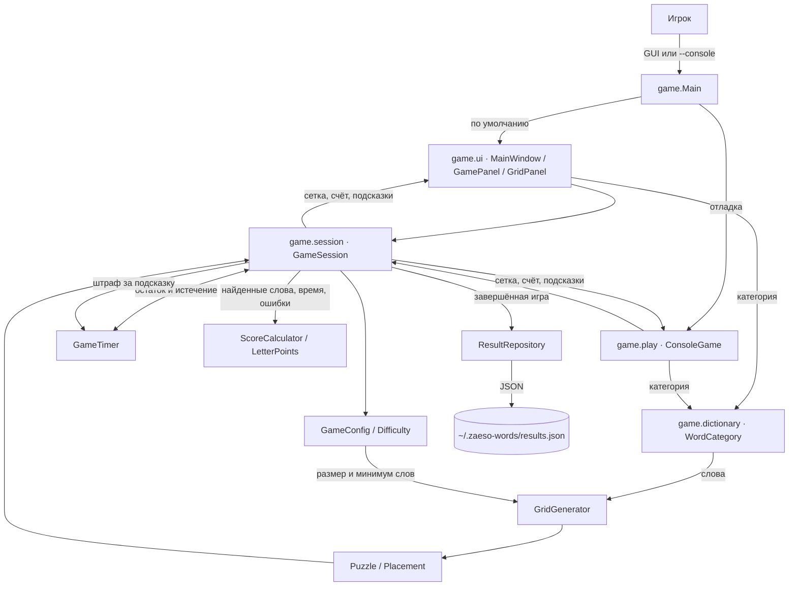
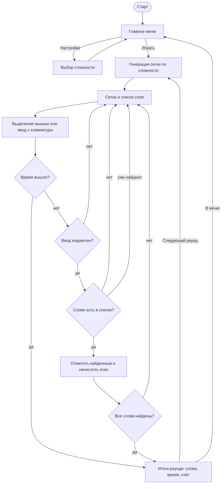
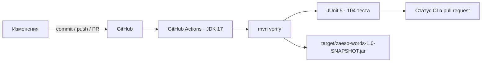
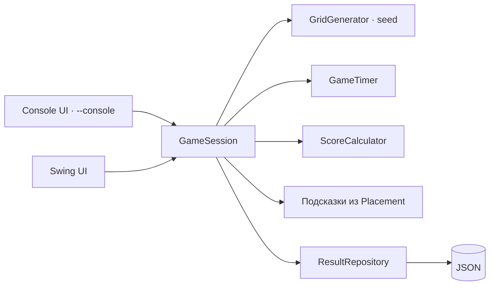

# zaeso-Words — актуальная карта проекта

Карта фиксирует фактическое состояние `main` и только незавершённый backlog.
Завершённые работы перечислены кратко и не дублируются среди активных задач.

**Последняя сверка:** 5 ноября 2026 года. Последний функциональный коммит —
`919792f`, версия в `pom.xml` — `1.0-SNAPSHOT`, тегов и релизов пока нет. Локальная
проверка `mvn clean verify` проходит: 104/104 теста, сборка JAR успешна. CI настроен
на GitHub Actions и запускается при push в `main` и при создании pull request.

**Статусы:** 🔴 следующий приоритет; 🟡 после него; ⚪ позднее или после
внешней подготовки; ✅ готово. Следующий приоритет — верхний 🔴.

## Снимок текущего состояния

| Показатель | Значение |
| --- | --- |
| Платформа | Java 17+, Swing GUI и консоль |
| Сборка | Maven, `maven-compiler-plugin` 3.13.0 |
| Тесты | JUnit 5, 104 теста, Surefire 3.5.2 |
| CI | GitHub Actions, Temurin JDK 17, `mvn verify` |
| Генерация | 10×10, 11×10, 10×11, 12×10, 10×12 |
| Игровой режим | Сетка, подсказки, очки, таймер по сложности, бесконечные раунды |
| Сохранения | JSON в `~/.zaeso-words/results.json`, топ-5 по очкам, сетке и сложности |
| Словари | 5 категорий в ресурсах: технологии, животные, космос, природа, еда |
| GUI | Swing: меню, настройки, интерактивная сетка, экран итогов |
| Релизы | Нет, только `1.0-SNAPSHOT` |

## Что уже сделано

| Дата | Коммит | Автор | За что отвечает |
| --- | --- | --- | --- |
| 2026-11-02 | [`fc8bfbf`](https://github.com/zaeso/zaeso-Words/commit/fc8bfbf) | zaeso | Начальный коммит: создание репозитория и базового README. |
| 2026-11-03 | [`52b47ae`](https://github.com/zaeso/zaeso-Words/commit/52b47ae) | zaeso | Базовая структура Java-проекта: модель, генератор сетки и консольный игровой режим. |
| 2026-11-03 | [`9e5c497`](https://github.com/zaeso/zaeso-Words/commit/9e5c497) | zaeso | Обновление файла дорожной карты проекта. |
| 2026-11-03 | [`8623f53`](https://github.com/zaeso/zaeso-Words/commit/8623f53) | zaeso | Таймер игры: `GameTimer`, обратный отсчёт, предупреждения, завершение по времени и вывод затраченного времени. |
| 2026-11-03 | [`4e4a9b8`](https://github.com/zaeso/zaeso-Words/commit/4e4a9b8) | zaeso | Первые тесты JUnit 5, Maven-сборка, CI GitHub Actions, `.gitignore` и раздел тестирования в README. |
| 2026-11-03 | [`8f7992e`](https://github.com/zaeso/zaeso-Words/commit/8f7992e) | zaeso | Обновление GitHub Actions: `checkout@v5`, `setup-java@v5`, runner `ubuntu-24.04`. |
| 2026-11-03 | [`945a298`](https://github.com/zaeso/zaeso-Words/commit/945a298) | zaeso | Добавление таблицы истории коммитов в дорожную карту. |
| 2026-11-03 | [`c6b7171`](https://github.com/zaeso/zaeso-Words/commit/c6b7171) | zaeso | Очистка дорожной карты от Python-обёртки, приведение файла к чистому Markdown. |
| 2026-11-03 | [`a9c201a`](https://github.com/zaeso/zaeso-Words/commit/a9c201a) | zaeso | Переработка дорожной карты: актуальные статусы, архитектура и backlog. |
| 2026-11-03 | [`0d0c869`](https://github.com/zaeso/zaeso-Words/commit/0d0c869) | zaeso | Улучшение обработки ввода: надёжный выбор размера и проверка слов, новые тесты. |
| 2026-11-04 | [`dbd2fae`](https://github.com/zaeso/zaeso-Words/commit/dbd2fae) | KENT | Детерминированная генерация по seed и полные тесты размещения: 32 теста, все 8 направлений, границы, пересечения, заполнение и нехватка места. |
| 2026-11-04 | [`7b3dc1a`](https://github.com/zaeso/zaeso-Words/commit/7b3dc1a) | KENT | Уточнение хеша `dbd2fae` в дорожной карте. |
| 2026-11-04 | [`74e682b`](https://github.com/zaeso/zaeso-Words/commit/74e682b) | KENT | Уровни сложности: `GameConfig`, профили «лёгкий/обычный/сложный», выбор в `Main`, параметры таймера и генератора из конфигурации. |
| 2026-11-04 | [`59918d7`](https://github.com/zaeso/zaeso-Words/commit/59918d7) | KENT | Уточнение хеша `74e682b` в дорожной карте. |
| 2026-11-05 | [`245836a`](https://github.com/zaeso/zaeso-Words/commit/245836a) | zaeso | Подсказки и сохранение результатов: штраф времени, лимит, JSON-хранилище, таблица рекордов и исполняемый JAR. |
| 2026-11-05 | [`0e65c83`](https://github.com/zaeso/zaeso-Words/commit/0e65c83) | zaeso | Система очков: стоимость букв по редкости, бонус за время, штрафы за ошибки и подсказки, счёт в результатах и топе. |
| 2026-11-05 | [`52ec6f4`](https://github.com/zaeso/zaeso-Words/commit/52ec6f4) | zaeso | Графический интерфейс Swing, общая `GameSession`, бесконечные раунды, экран итогов и общий словарь `WordBank`; консоль переведена в отладочный режим `--console`. |
| 2026-11-05 | [`5f049b9`](https://github.com/zaeso/zaeso-Words/commit/5f049b9) | zaeso | Категории и внешние словари: `WordCategory`, ресурсы `dictionaries/`, выбор категории в GUI и консоли, `GenerationResult` с сообщением о нехватке слов. |
| 2026-11-05 | [`919792f`](https://github.com/zaeso/zaeso-Words/commit/919792f) | KENT | Завершение P1: описание категорий и словарей в README и дорожной карте, стабильные временные каталоги в тестах. |

### Ключевые результаты

- ✅ Реализована генерация буквенной сетки.
- ✅ Генерация воспроизводима: `GridGenerator` принимает seed или `Random`.
- ✅ Параметры игры вынесены в `GameConfig`, доступны три уровня сложности.
- ✅ Слова размещаются в 8 направлениях и могут пересекаться на одинаковых буквах.
- ✅ Пустые клетки заполняются случайными буквами.
- ✅ Работает консольный игровой цикл с проверкой слов и защитой от повторов.
- ✅ Добавлен таймер с предупреждениями и завершением игры по истечении времени.
- ✅ Добавлены первые тесты JUnit 5 и CI.
- ✅ Настроены Maven и GitHub Actions.
- ✅ README содержит запуск, описание алгоритма, сложности, таймера и тестирования.
- ✅ Некорректный ввод обрабатывается без выхода из игры: размер запрашивается
  заново, пустые, латинские и слишком длинные слова отклоняются с пояснением.
- ✅ Подсказки открывают длину, первую букву и направление слова за штраф
  времени; лимит и повторный штраф за то же слово исключены.
- ✅ Результаты сохраняются локально в JSON, а после игры показывается топ
  по размеру сетки и сложности.
- ✅ Работает система очков: редкие буквы дороже частых, учитываются
  оставшееся время, ошибки и подсказки; счёт сохраняется и участвует в топе.
- ✅ Добавлен Swing-интерфейс: меню, настройки сложности, интерактивная сетка,
  список слов, подсказки, экран итогов и таблица рекордов.
- ✅ Игровая логика вынесена в общую `GameSession`, консоль оставлена
  отладочным режимом `--console`.
- ✅ Раунды бесконечные: общий счёт накапливается, а следующий раунд
  запускается с экрана итогов.
- ✅ Категории слов вынесены в ресурсы `dictionaries/`: категория выбирается
  в GUI и консоли, а индекс `categories.txt` не требует правки Java-кода.
- ✅ Оформление GUI использует красный, синий и зелёный цвета; слова можно
  находить мышью и вводить с клавиатуры.

## Рабочие возможности

- Игрок выбирает сложность: «лёгкий», «обычный» или «сложный». Профиль задаёт
  минимальное число слов, лимит времени, число подсказок и размер сетки по
  умолчанию.
- Размер сетки можно оставить из профиля (Enter) или выбрать один из допустимых:
  10×10, 11×10, 10×11, 12×10 или 10×12.
- Генератор нормализует словарь: верхний регистр, удаление посторонних
  символов, дедупликация и отсев слов, которые не помещаются в сетку.
- Генератор воспроизводим при одинаковом seed и одинаковых входных данных.
- Длинные слова размещаются раньше коротких, чтобы уменьшить число неудачных
  раскладок.
- Сетка заполняется полностью: пустые клетки получают случайные русские буквы.
- Игрок вводит слово целиком; регистр не важен, повторно найденное слово
  отклоняется.
- Некорректный размер сетки запрашивается заново. Пустой ввод, слова с
  латиницей или другими символами и слишком длинные слова отклоняются с
  пояснением, игра продолжается.
- `EXIT` принимается в любом регистре.
- Лимит времени зависит от сложности: 7, 5 или 4 минуты. Оставшееся время
  показывается в приглашении, предупреждения выводятся за 60, 30 и последние
  10 секунд.
- После завершения игра показывает результат, затраченное время, причину
  завершения и оставшиеся слова.
- `HINT` или `ПОДСКАЗКА` открывает длину, первую букву и направление слова,
  но не слово целиком и не координаты. Подсказка стоит 30 секунд, число
  подсказок задаётся сложностью, повторно за то же слово штраф не берётся.
- Завершённая игра сохраняется в `~/.zaeso-words/results.json` атомарной
  записью. Повреждённый файл резервируется, а игра продолжается.
- После игры выводится топ-5 по размеру сетки и сложности: сначала больше
  очков, затем больше найденных слов, затем меньше времени.
- Очки начисляются за буквы найденных слов: редкие буквы стоят дороже частых.
  Бонус за оставшееся время даётся только при полном прохождении. Ошибки и
  подсказки уменьшают счёт; итог и разбивка показываются после игры.
- `mvn verify` собирает проект, запускает тесты и создаёт JAR.
- CI проверяет push в `main` и pull request на JDK 17.
- GUI запускается по умолчанию, консоль доступна флагом `--console`.
- В GUI есть главное меню, настройки сложности, интерактивная сетка,
  список слов, подсказка, таблица рекордов и экран итогов раунда.
- Слова можно выделять протягиванием мыши или вводить в поле и подтверждать
  клавишей Enter.
- Раунды бесконечные: после итогов можно начать следующий раунд, сохранив
  накопленный общий счёт.
- Размер сетки в GUI не выбирается отдельно: он берётся из профиля сложности.
- Категория слов выбирается в настройках GUI или номером/названием в консоли;
  доступны технологии, животные, космос, природа и еда.
- Словари загружаются из `src/main/resources/dictionaries/` по индексу
  `categories.txt`; новая категория добавляется без изменения Java-кода.
- Если в категории не хватает подходящих слов, генератор возвращает понятное
  сообщение о том, сколько слов нужно и сколько подходит.
- Оформление использует красный, синий и зелёный цвета.

## Ограничения текущей версии

- Категории поставляются вместе с игрой; подключение пользовательского файла
  словаря без пересборки проекта пока не поддерживается.
- `Puzzle.getGrid()` возвращает изменяемый массив, поэтому модель пока не
  защищает сетку от внешней записи.
- Настройки GUI ограничены сложностью и категорией: тема, звук и анимации не настраиваются.

## Архитектура

### Текущий контур

| Слой | Сейчас отвечает за | Граница и гарантия |
| --- | --- | --- |
| `game.Main` | Запуск GUI по умолчанию или консоли по флагу `--console` | Не содержит игровой логики; консольный выбор размера остаётся отладочным. |
| `game.ui` | Swing-меню, настройки, сетка, экран итогов | Не дублирует правила игры: ввод и отрисовка опираются на `GameSession`. |
| `game.session` | Проверка слов, подсказки, таймер, счёт, завершение раунда | Общая логика для GUI и консоли. |
| `game.config` | `GameConfig` и профили `Difficulty` | Не зависит от интерфейса; валидирует параметры и хранит размер, минимум слов, время и подсказки. |
| `game.generator` | Нормализация слов, размещение, заполнение сетки | Не работает с вводом и выводом; принимает seed/`Random`; `generateChecked` возвращает `Puzzle` или `GenerationResult` с причиной отказа. |
| `game.model` | `Direction`, `Placement`, `Puzzle` | Модель не знает об интерфейсе; список размещений копируется в `Puzzle`. |
| `game.dictionary` | `WordCategory` и загрузка словарей из ресурсов | Индекс и словари читаются из `dictionaries/`; `WordBank` — категория по умолчанию для совместимости. |
| `game.play` | Отладочный консольный цикл и `GameTimer` | Отвечает за консольный ввод/вывод; игровые правила берёт из `GameSession`. |
| `game.score` | `LetterPoints` и `ScoreCalculator` | Не зависят от интерфейса; считают стоимость букв и итог по найденным словам, времени, ошибкам и подсказкам. |
| `game.result` | `GameResult` и `ResultRepository` | Хранит результаты в JSON, атомарно пишет, переживает повреждённый файл и строит топ по очкам, сетке и сложности. |
| `src/test` | Проверка модели, генератора, таймера, сессии и консольного сценария | JUnit 5, запуск через Surefire. |
| Maven и CI | Компиляция, тесты, JAR, автоматическая проверка | `target/` исключён из Git, CI использует JDK 17. |

### Игровой процесс

### Сборка и проверка

### Архитектура после разделения

Игровая логика уже вынесена в `GameSession`, поэтому её используют и Swing,
и отладочная консоль. Следующие интерфейсы и режимы должны подключаться к той
же сессии.

## Актуальный roadmap

Завершённые задачи остаются только в таблице выше. Ниже — только работа,
которая ещё не выполнена. Порядок ближайшей работы: **1 → 2**, затем 3–5.

### 🔴 P1 — параметры игры

1. **Выбор параметров игры.**
   Разрешить выбирать размер сетки, сложность, категорию и длительность игры
   в одном меню. Критерий: параметры валидируются до генерации, значения по
   умолчанию сохраняются между запусками.

### 🟡 P2 — выпуск и развитие интерфейса

2. **Упаковка и первый релиз.**
   Собрать исполняемый JAR, добавить версию, тег и GitHub Release с
   инструкцией запуска. Приложить JAR к релизу из CI. Критерий: чистый
   пользователь скачивает артефакт и запускает игру по README без Maven.

### ⚪ P3 — дополнительные улучшения

3. **Гибкая настройка интерфейса.**
   Добавить выбор темы, звуковые эффекты и отключаемые анимации подсветки.
   Критерий: настройки сохраняются между запусками и не влияют на игровую
   логику в `GameSession`.

4. **Ежедневная головоломка и статистика.**
   Генерировать сетку дня по фиксированному seed и показывать личную
   статистику: лучший счёт, серию дней и число найденных слов. Критерий:
   одинаковая дата даёт одинаковую сетку у всех игроков.

5. **Экспорт результатов.**
   Добавить экспорт истории в CSV и просмотр полной таблицы рекордов вместо
   топ-5. Критерий: файл открывается в табличном редакторе, а экспорт не
   ломает существующий JSON.

## Что больше не является активной задачей

- Базовая структура Java-проекта и разделение на `model`, `generator`, `play`
  закрыты в `52b47ae`.
- Генерация сетки, 8 направлений, пересечения и случайное заполнение закрыты
  в `52b47ae`.
- Детерминированная генерация по seed и полные тесты размещения закрыты
  в `dbd2fae`.
- Уровни сложности, `GameConfig` и выбор профиля в `Main` закрыты
  в `74e682b`.
- Консольный игровой режим и проверка введённых слов закрыты в `52b47ae`.
- Надёжная обработка размера сетки и словесного ввода с тестами закрыта
  в `0d0c869`.
- Таймер, предупреждения и завершение по времени закрыты в `8623f53`.
- Подсказки с лимитом, штрафом времени и защитой от повторного списания
  закрыты в `245836a`.
- Сохранение результатов в JSON и таблица рекордов закрыты в `245836a`.
- Система очков со стоимостью букв, бонусом за время и штрафами закрыта
  в `0e65c83`.
- Swing GUI, общая `GameSession`, бесконечные раунды и экран итогов закрыты
  в `52ec6f4`.
- Категории и внешние словари с индексом ресурсов, выбором категории и
  понятными ошибками генератора закрыты в `5f049b9`.
- Первые тесты, Maven, CI и `.gitignore` закрыты в `4e4a9b8`.
- Обновление версий GitHub Actions закрыто в `8f7992e`.
- Формат дорожной карты приведён к чистому Markdown в `c6b7171`.

## Правила готовности изменений

1. `mvn verify` проходит локально: сборка, тесты и создание JAR.
2. Новое поведение покрыто тестами; изменения генератора проверяют границы,
   пересечения и все 8 направлений.
3. Проект остаётся совместимым с Java 17+.
4. README и дорожная карта обновляются вместе с функциональностью.
5. `target/`, `out/`, `.idea/` и `*.iml` не попадают в Git.
6. CI зелёный на push в `main` и в pull request.
7. В коммит не попадают секреты, временные файлы и сгенерированные артефакты.
