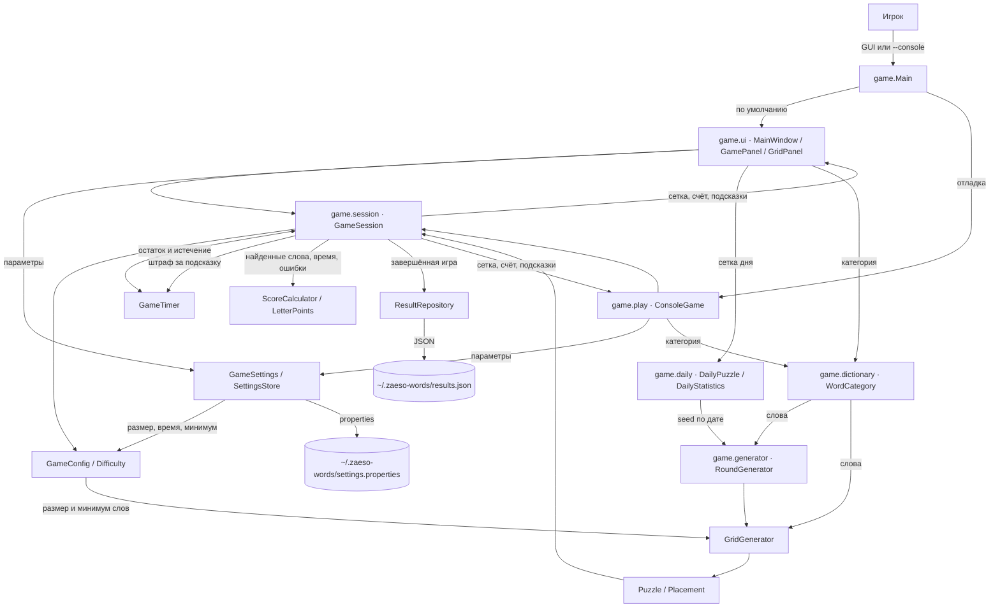
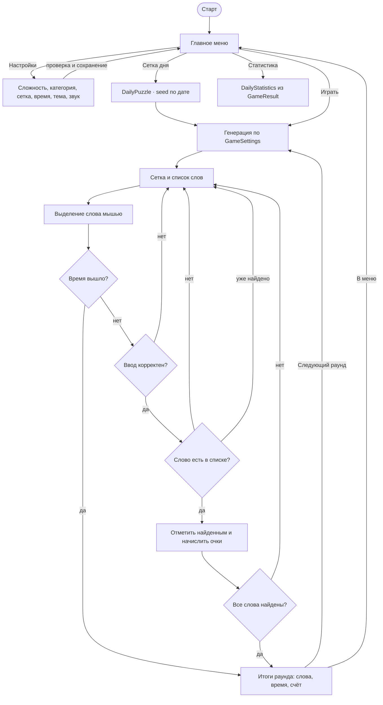
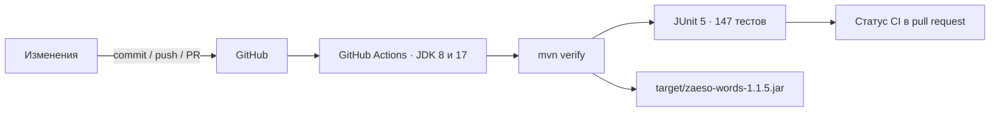
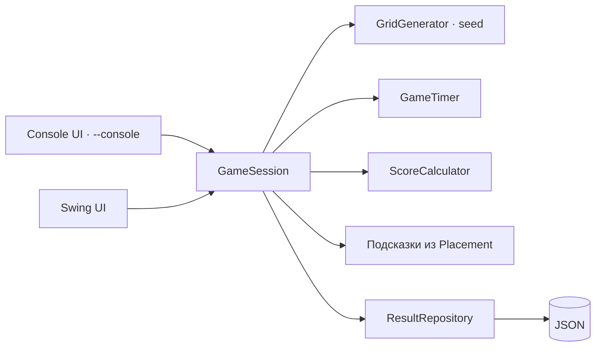

# zaeso-Words — актуальная карта проекта

Карта фиксирует фактическое состояние `main` и только незавершённый backlog.
Завершённые работы перечислены кратко и не дублируются среди активных задач.

**Последняя сверка:** 14 ноября 2026 года. Версия в `pom.xml` — `1.1.5`,
выпущен тег `v1.1.5` и GitHub Release с исполняемым JAR и `run-game.bat`.
Список слов переделан в аккуратные плашки-чипы по алфавиту: найденные
подсвечены своим цветом и по клику вспыхивают на сетке, ненайденные —
нейтральные. Работа интерфейса
проверена на настоящей Java 8 (Temurin 1.8.0_512).
Локальная проверка `mvn clean verify` проходит: 147/147 тестов, сборка JAR
успешна, байткод — Java 8 (major 52). CI настроен на GitHub Actions и
запускается при push в `main`, при создании pull request и при push тега
`v*`; на теге CI прикрепляет JAR и bat-запускатор к релизу.

**Статусы:** 🔴 следующий приоритет; 🟡 после него; ⚪ позднее или после
внешней подготовки; ✅ готово. Следующий приоритет — верхний 🔴.

## Снимок текущего состояния

| Показатель | Значение |
| --- | --- |
| Платформа | Java 8+, Swing GUI и консоль |
| Сборка | Maven, `maven-compiler-plugin` 3.13.0 |
| Тесты | JUnit 5, 147 тестов, Surefire 3.5.2 |
| CI | GitHub Actions, Temurin JDK 8 и 17, `mvn verify` |
| Генерация | 10×10, 11×10, 10×11, 12×10, 10×12 |
| Игровой режим | Сетка, подсказки, очки, настраиваемое время, бесконечные раунды, ежедневная сетка |
| Сохранения | JSON в `~/.zaeso-words/results.json`, полная таблица рекордов и экспорт истории в CSV |
| Настройки | `~/.zaeso-words/settings.properties`: сложность, категория, сетка, время, тема, звук, анимации |
| Словари | 6 категорий: технологии, животные, космос, природа, еда и полный список русских слов (1 092 245 словоформ) |
| GUI | Swing: меню, настройки, интерактивная сетка, экран итогов, темы, звук, статистика |
| Релизы | `v1.1.5`, JAR и `run-game.bat` прикрепляются к GitHub Release из CI |

## Что уже сделано

| Дата | Коммит | Автор | За что отвечает |
| --- | --- | --- | --- |
| 2026-11-02 | [`fc8bfbf`](https://github.com/zaeso/zaeso-Words/commit/fc8bfbf) | zaeso | Начальный коммит: создание репозитория и базового README. |
| 2026-11-03 | [`52b47ae`](https://github.com/zaeso/zaeso-Words/commit/52b47ae) | zaeso | Базовая структура Java-проекта: модель, генератор сетки и консольный игровой режим. |
| 2026-11-03 | [`9e5c497`](https://github.com/zaeso/zaeso-Words/commit/9e5c497) | zaeso | Обновление файла дорожной карты проекта. |
| 2026-11-03 | [`8623f53`](https://github.com/zaeso/zaeso-Words/commit/8623f53) | zaeso | Таймер игры: `GameTimer`, обратный отсчёт, предупреждения, завершение по времени и вывод затраченного времени. |
| 2026-11-03 | [`4e4a9b8`](https://github.com/zaeso/zaeso-Words/commit/4e4a9b8) | zaeso | Первые тесты JUnit 5, Maven-сборка, CI GitHub Actions, `.gitignore` и раздел тестирования в README. |
| 2026-11-03 | [`8f7992e`](https://github.com/zaeso/zaeso-Words/commit/8f7992e) | zaeso | Обновление GitHub Actions: `checkout@v5`, `setup-java@v5`, runner `ubuntu-24.04`. |
| 2026-11-03 | [`945a298`](https://github.com/zaeso/zaeso-Words/commit/945a298) | zaeso | Добавление таблицы истории коммитов в дорожную карту. |
| 2026-11-03 | [`c6b7171`](https://github.com/zaeso/zaeso-Words/commit/c6b7171) | zaeso | Очистка дорожной карты от Python-обёртки, приведение файла к чистому Markdown. |
| 2026-11-03 | [`a9c201a`](https://github.com/zaeso/zaeso-Words/commit/a9c201a) | zaeso | Переработка дорожной карты: актуальные статусы, архитектура и backlog. |
| 2026-11-03 | [`0d0c869`](https://github.com/zaeso/zaeso-Words/commit/0d0c869) | zaeso | Улучшение обработки ввода: надёжный выбор размера и проверка слов, новые тесты. |
| 2026-11-04 | [`dbd2fae`](https://github.com/zaeso/zaeso-Words/commit/dbd2fae) | KENT | Детерминированная генерация по seed и полные тесты размещения: 32 теста, все 8 направлений, границы, пересечения, заполнение и нехватка места. |
| 2026-11-04 | [`7b3dc1a`](https://github.com/zaeso/zaeso-Words/commit/7b3dc1a) | KENT | Уточнение хеша `dbd2fae` в дорожной карте. |
| 2026-11-04 | [`74e682b`](https://github.com/zaeso/zaeso-Words/commit/74e682b) | KENT | Уровни сложности: `GameConfig`, профили «лёгкий/обычный/сложный», выбор в `Main`, параметры таймера и генератора из конфигурации. |
| 2026-11-04 | [`59918d7`](https://github.com/zaeso/zaeso-Words/commit/59918d7) | KENT | Уточнение хеша `74e682b` в дорожной карте. |
| 2026-11-05 | [`245836a`](https://github.com/zaeso/zaeso-Words/commit/245836a) | zaeso | Подсказки и сохранение результатов: штраф времени, лимит, JSON-хранилище, таблица рекордов и исполняемый JAR. |
| 2026-11-05 | [`0e65c83`](https://github.com/zaeso/zaeso-Words/commit/0e65c83) | zaeso | Система очков: стоимость букв по редкости, бонус за время, штрафы за ошибки и подсказки, счёт в результатах и топе. |
| 2026-11-05 | [`52ec6f4`](https://github.com/zaeso/zaeso-Words/commit/52ec6f4) | zaeso | Графический интерфейс Swing, общая `GameSession`, бесконечные раунды, экран итогов и общий словарь `WordBank`; консоль переведена в отладочный режим `--console`. |
| 2026-11-05 | [`5f049b9`](https://github.com/zaeso/zaeso-Words/commit/5f049b9) | zaeso | Категории и внешние словари: `WordCategory`, ресурсы `dictionaries/`, выбор категории в GUI и консоли, `GenerationResult` с сообщением о нехватке слов. |
| 2026-11-05 | [`919792f`](https://github.com/zaeso/zaeso-Words/commit/919792f) | KENT | Описание категорий и словарей в README и дорожной карте, стабильные временные каталоги в тестах. |
| 2026-11-06 | [`563dac7`](https://github.com/zaeso/zaeso-Words/commit/563dac7) | KENT | Единые параметры игры: `GameSettings`, сохранение в `settings.properties`, выбор сложности, категории, сетки и времени в GUI и консоли. |
| 2026-11-06 | [`ade3a2a`](https://github.com/zaeso/zaeso-Words/commit/ade3a2a) | zaeso | P2: темы «Классика/Океан/Лес/Тёмная», звуковые эффекты, отключаемая анимация подсветки и их независимое сохранение; ввод в GUI только мышью. |
| 2026-11-06 | [`f456a9e`](https://github.com/zaeso/zaeso-Words/commit/f456a9e) | zaeso | P1: версия `1.0.0`, инструкция запуска готового JAR в README, сборка и прикрепление JAR к GitHub Release из CI. |
| 2026-11-06 | `1.0.1` | zaeso | Полный список русских слов (1 092 245 словоформ) со случайной выборкой в каждом раунде, bat-запускатор в релизе, версия `1.0.1`. |
| 2026-11-06 | `1.0.2` | zaeso | Срочный фикс: в категории «Все русские слова» для сетки берутся слова до 10 букв, поэтому генерация 12 слов на 10×12 больше не срывается. |
| 2026-11-06 | `1.0.3` | zaeso | Выборка по длине слов с перекосом в сторону коротких и приоритет диагональных направлений в генераторе. |
| 2026-11-06 | `1.0.4` | zaeso | Зелёная подсветка буквы подсказки на сетке и разные цвета для найденных слов в сетке и списке. |
| 2026-11-06 | `db1eb92` | KENT | P3: ежедневная сетка по seed даты, `RoundGenerator`, личная статистика по лучшему счёту, серии дней и найденным словам. |
| 2026-11-07 | `1.0.5` | zaeso | P4: полная таблица рекордов вместо топ-5 и экспорт всей истории игр в CSV (UTF-8 с BOM, разделитель `;`). |
| 2026-11-11 | `1.1.5` | zaeso | Финальный релиз: полная совместимость с Java 8 и доработанный интерфейс — подсветка кнопок, аккуратные меню и экраны. |
| 2026-11-11 | `1.1.5` | zaeso | Исправление интерфейса: кнопки рисуются независимо от темы оформления и всегда видны, градиентные шапки, кнопка «Сохранить» в настройках. |
| 2026-11-12 | `1.1.5` | zaeso | Адаптивные цвета найденных слов (не сливаются с фоном), цветные акценты и иконки во всех меню, экран статистики с плитками; проверка запуска на настоящей Java 8. |
| 2026-11-12 | `1.1.5` | zaeso | Доводка красоты: кнопки с градиентом, бликом и тенью, декоративный фон меню и подпись версии, тени карточек, цветные полоски на плитках, градиентная шапка рекордов. |
| 2026-11-12 | `1.1.5` | zaeso | Логика игрового экрана: выделение двумя кликами и протягиванием, отмена правой кнопкой и Escape, предпросмотр слова, счётчик прогресса, предупреждение о времени, кнопка «Завершить раунд», умная кнопка подсказок. |
| 2026-11-12 | `1.1.5` | zaeso | Красота игрового экрана: плашки-бейджи в шапке, тени и декор клеток, разбор очков плитками на экране итогов. |
| 2026-11-14 | `1.1.5` | zaeso | Список слов в чипах: сортировка по алфавиту, найденные — цветные плашки с подсветкой на сетке по клику. |

### Ключевые результаты

- ✅ Реализована генерация буквенной сетки.
- ✅ Генерация воспроизводима: `GridGenerator` принимает seed или `Random`.
- ✅ Параметры игры вынесены в `GameConfig`, доступны три уровня сложности.
- ✅ Слова размещаются в 8 направлениях и могут пересекаться на одинаковых буквах.
- ✅ Пустые клетки заполняются случайными буквами.
- ✅ Работает консольный игровой цикл с проверкой слов и защитой от повторов.
- ✅ Добавлен таймер с предупреждениями и завершением игры по истечении времени.
- ✅ Добавлены первые тесты JUnit 5 и CI.
- ✅ Настроены Maven и GitHub Actions.
- ✅ README содержит запуск, описание алгоритма, сложности, таймера и тестирования.
- ✅ Некорректный ввод обрабатывается без выхода из игры: размер запрашивается
  заново, пустые, латинские и слишком длинные слова отклоняются с пояснением.
- ✅ Подсказки открывают длину, первую букву и направление слова за штраф
  времени; лимит и повторный штраф за то же слово исключены.
- ✅ Результаты сохраняются локально в JSON, а после игры показывается топ
  по размеру сетки и сложности.
- ✅ Работает система очков: редкие буквы дороже частых, учитываются
  оставшееся время, ошибки и подсказки; счёт сохраняется и участвует в топе.
- ✅ Добавлен Swing-интерфейс: меню, настройки сложности, интерактивная сетка,
  список слов, подсказки, экран итогов и таблица рекордов.
- ✅ Игровая логика вынесена в общую `GameSession`, консоль оставлена
  отладочным режимом `--console`.
- ✅ Раунды бесконечные: общий счёт накапливается, а следующий раунд
  запускается с экрана итогов.
- ✅ Категории слов вынесены в ресурсы `dictionaries/`: категория выбирается
  в GUI и консоли, а индекс `categories.txt` не требует правки Java-кода.
- ✅ Сложность, категория, размер сетки и длительность выбираются в одном
  меню, проверяются до генерации и сохраняются между запусками.
- ✅ Оформление GUI переключается между темами, звук и анимация подсветки
  настраиваются отдельно; слова находятся выделением мышью.
- ✅ Выпущен `v1.0.0`: готовый JAR прикрепляется к GitHub Release из CI,
  а README объясняет запуск без Maven.
- ✅ Добавлена категория «Все русские слова» на 1 092 245 словоформ из
  открытого набора `danakt/russian-words` (MIT). Большой словарь читается
  потоково, а каждый раунд получает новую случайную выборку слов.
- ✅ Выпущен `v1.0.1`: в релиз входят JAR и `run-game.bat` для запуска
  двойным кликом без терминала.
- ✅ Исправлена генерация в категории «Все русские слова»: слова длиннее
  10 букв не попадают в игровую выборку, поэтому сетка 10×12 стабильно
  собирает минимум 12 слов. Выпущен `v1.0.2`.
- ✅ Выборка из полного словаря стратифицирована по длине: коротких слов
  стало заметно больше. Диагональные направления размещаются чаще прямых.
  Выпущен `v1.0.3`.
- ✅ Подсказка подсвечивает первую букву слова зелёным прямо на сетке,
  а найденные слова получают разные цвета в сетке и списке. Выпущен `v1.0.4`.
- ✅ Ежедневная сетка строится по seed даты, а личная статистика показывает
  лучший счёт, серию дней и найденные слова.
- ✅ Таблица рекордов показывает все результаты текущего режима, а история
  игр экспортируется в CSV, не изменяя `results.json`. Выпущен `v1.0.5`.
- ✅ Ежедневная сетка зависит только от даты: одинаковый seed у всех игроков.
  Личная статистика показывает лучший счёт, серию дней и найденные слова.

## Рабочие возможности

- Игрок выбирает сложность: «лёгкий», «обычный» или «сложный». Профиль задаёт
  минимальное число слов, число подсказок, а также размер и время по умолчанию.
- Размер сетки можно оставить из профиля (Enter) или выбрать один из допустимых:
  10×10, 11×10, 10×11, 12×10 или 10×12.
- В GUI сложность, категория, размер сетки и длительность выбираются на одном
  экране настроек; в консоли те же параметры запрашиваются по очереди.
- Выбранные параметры сохраняются в `~/.zaeso-words/settings.properties` и
  восстанавливаются при следующем запуске.
- До генерации `GameSettings` проверяет размер, длительность от 1 до 60 минут
  и наличие нужного числа слов в категории.
- Генератор нормализует словарь: верхний регистр, удаление посторонних
  символов, дедупликация и отсев слов, которые не помещаются в сетку.
- Генератор воспроизводим при одинаковом seed и одинаковых входных данных.
- Длинные слова размещаются раньше коротких, чтобы уменьшить число неудачных
  раскладок.
- Сетка заполняется полностью: пустые клетки получают случайные русские буквы.
- Игрок вводит слово целиком; регистр не важен, повторно найденное слово
  отклоняется.
- Некорректный размер сетки запрашивается заново. Пустой ввод, слова с
  латиницей или другими символами и слишком длинные слова отклоняются с
  пояснением, игра продолжается.
- `EXIT` принимается в любом регистре.
- Лимит времени по умолчанию зависит от сложности: 7, 5 или 4 минуты; его
  можно изменить в диапазоне 1–60 минут. Оставшееся время показывается в
  приглашении, предупреждения выводятся за 60, 30 и последние 10 секунд.
- После завершения игра показывает результат, затраченное время, причину
  завершения и оставшиеся слова.
- `HINT` или `ПОДСКАЗКА` открывает длину, первую букву и направление слова,
  но не слово целиком и не координаты. Подсказка стоит 30 секунд, число
  подсказок задаётся сложностью, повторно за то же слово штраф не берётся.
- Завершённая игра сохраняется в `~/.zaeso-words/results.json` атомарной
  записью. Повреждённый файл резервируется, а игра продолжается.
- После игры кнопка «Рекорды» показывает полную таблицу по размеру сетки
  и сложности: сначала больше очков, затем больше найденных слов, затем
  меньше времени. Таблицу можно сортировать по столбцам.
- История игр экспортируется в CSV: UTF-8 с BOM, разделитель `;`, все
  сохранённые записи. Экспорт читает `results.json` и не меняет его.
- Очки начисляются за буквы найденных слов: редкие буквы стоят дороже частых.
  Бонус за оставшееся время даётся только при полном прохождении. Ошибки и
  подсказки уменьшают счёт; итог и разбивка показываются после игры.
- `mvn verify` собирает проект, запускает тесты и создаёт JAR.
- CI проверяет push в `main` и pull request на JDK 8 и JDK 17; релиз собирается на JDK 17 в байткод 8.
- GUI запускается по умолчанию, консоль доступна флагом `--console`.
- В GUI есть главное меню, настройки сложности, категории, сетки и времени,
  интерактивная сетка, список слов, подсказка, таблица рекордов и экран итогов.
- Слова можно выделять протягиванием мыши или вводить в поле и подтверждать
  клавишей Enter.
- Раунды бесконечные: после итогов можно начать следующий раунд, сохранив
  накопленный общий счёт.
- «Сетка дня» запускает ежедневную головоломку с фиксированными сложностью,
  словарём, сеткой и временем. Seed вычисляется из даты через SplitMix64,
  поэтому одна и та же дата даёт одинаковую сетку у всех игроков, а
  сохранённые настройки на неё не влияют.
- Результаты ежедневных игр сохраняются с названием сложности «Ежедневная»
  и не смешиваются с обычными рекордами.
- «Статистика» показывает лучший счёт, текущую серию дней, число дней с
  ежедневными играми и суммарное число найденных слов. Серия продолжается,
  если последняя сетка пройдена сегодня или вчера.
- При смене сложности размер и время подставляются из её профиля, но остаются
  доступными для изменения.
- Категория слов выбирается в настройках GUI или номером/названием в консоли;
  доступны технологии, животные, космос, природа, еда и все русские слова.
- Категория «Все русские слова» содержит более миллиона словоформ длиной
  3–12 букв. Для игровой сетки из них выбираются слова до 10 букв: более
  длинные плохо помещаются вместе с остальными. Файл не загружается в память
  целиком: `RussianWords` строит случайную выборку, из которой каждый раунд
  берёт новые слова. Выборка стратифицирована по длине, поэтому коротких слов
  много, а диагональные направления размещаются чаще прямых.
- Словари загружаются из `src/main/resources/dictionaries/` по индексу
  `categories.txt`; новая категория добавляется без изменения Java-кода.
- Если в категории не хватает подходящих слов, генератор возвращает понятное
  сообщение о том, сколько слов нужно и сколько подходит.
- В настройках выбираются темы «Классика», «Океан», «Лес» и «Тёмная»,
  звуковые эффекты и анимация подсветки найденных букв.
- Параметры игры и оформления сохраняются в одном properties-файле независимо:
  изменение темы не сбрасывает сложность и словарь, и наоборот.
- В GUI слова находятся только выделением мышью; текстового поля и ввода
  с клавиатуры нет. Консольный режим по-прежнему принимает слова строкой.
- Найденные слова подсвечиваются на сетке и в списке разными цветами, чтобы
  соседние слова было легко различить.
- Подсказка в GUI подсвечивает на сетке зелёным клетку с первой буквой
  загаданного слова.
- Готовый JAR `zaeso-words-1.1.5.jar` и `run-game.bat` скачиваются из
  GitHub Release. Запуск — двойным кликом по bat или командой `java -jar`
  при наличии Java 8+.

## Ограничения текущей версии

- Категории поставляются вместе с игрой; подключение пользовательского файла
  словаря без пересборки проекта пока не поддерживается.
- `Puzzle.getGrid()` возвращает изменяемый массив, поэтому модель пока не
  защищает сетку от внешней записи.
- Звук синтезируется стандартными средствами Java; на машине без звукового
  устройства сигналы молча пропускаются.
- Пользовательский файл словаря по-прежнему добавляется только в ресурсы
  проекта, без выбора произвольного файла из интерфейса.

## Архитектура

### Текущий контур

| Слой | Сейчас отвечает за | Граница и гарантия |
| --- | --- | --- |
| `game.Main` | Запуск GUI по умолчанию или консоли по флагу `--console` | Не содержит игровой логики; консольный режим использует те же `GameSettings` и `SettingsStore`. |
| `game.ui` | Swing-меню, настройки, темы, звук, сетка, экран итогов | Не дублирует правила игры: выделение и отрисовка опираются на `GameSession`; оформление не меняет игровую логику. |
| `game.session` | Проверка слов, подсказки, таймер, счёт, завершение раунда | Общая логика для GUI и консоли. |
| `game.config` | `GameConfig`, `Difficulty`, `GameSettings`, `UiSettings` и `SettingsStore` | Не зависит от интерфейса; валидирует размер, время и наличие слов, независимо сохраняет параметры игры и оформления. |
| `game.generator` | Нормализация слов, размещение, заполнение сетки, `RoundGenerator` | Не работает с вводом и выводом; принимает seed/`Random`; `RoundGenerator` использует один seed для выборки слов и сетки; `generateChecked` возвращает `Puzzle` или `GenerationResult` с причиной отказа. |
| `game.daily` | `DailyPuzzle` и `DailyStatistics` | Seed и параметры зависят только от даты, а не от настроек игрока; статистика считается из сохранённых результатов с меткой «Ежедневная». |
| `game.model` | `Direction`, `Placement`, `Puzzle` | Модель не знает об интерфейсе; список размещений копируется в `Puzzle`. |
| `game.dictionary` | `WordCategory`, `RussianWords` и загрузка словарей из ресурсов | Индекс и словари читаются из `dictionaries/`; большие словари работают в режиме `stream` со случайной выборкой; `WordBank` — категория по умолчанию для совместимости. |
| `game.play` | Отладочный консольный цикл и `GameTimer` | Отвечает за консольный ввод/вывод; игровые правила берёт из `GameSession`. |
| `game.score` | `LetterPoints` и `ScoreCalculator` | Не зависят от интерфейса; считают стоимость букв и итог по найденным словам, времени, ошибкам и подсказкам. |
| `game.result` | `GameResult`, `ResultRepository` и `ResultCsvExporter` | Хранит результаты в JSON, атомарно пишет, переживает повреждённый файл, строит полную таблицу по очкам и экспортирует историю в CSV без изменения JSON. |
| `src/test` | Проверка модели, генератора, таймера, сессии и консольного сценария | JUnit 5, запуск через Surefire. |
| Maven и CI | Компиляция, тесты, JAR, автоматическая проверка | `target/` исключён из Git, CI использует JDK 8 и 17. |

### Игровой процесс

### Сборка и проверка

### Архитектура после разделения

Игровая логика уже вынесена в `GameSession`, поэтому её используют и Swing,
и отладочная консоль. Следующие интерфейсы и режимы должны подключаться к той
же сессии.

## Актуальный roadmap

Все запланированные приоритеты P1–P4 закрыты: первый релиз, оформление,
ежедневная сетка со статистикой, полная таблица рекордов и экспорт CSV.
Активных задач в текущем backlog нет; новые пункты добавляются сюда по мере
появления.

### ✅ P4 — экспорт результатов

4. **Экспорт истории.**
   Экспорт истории в CSV и просмотр полной таблицы рекордов вместо топ-5
   закрыты в версии `1.0.5`.

### ✅ Финальный релиз — Java 8 и новый интерфейс

5. **Совместимость и оформление.**
   Игра переведена на Java 8: record-классы заменены обычными классами,
   switch-выражения, `var`, `Path.of`, `Files.readString/writeString`,
   `List.of`, `String.lines` и другие API Java 9+ убраны. bat-файл теперь
   принимает Java 8 и новее, CI гоняет тесты на Temurin JDK 8 и 17.
   Интерфейс доработан: кнопки с подсветкой при наведении и мягким нажатием,
   более аккуратные экраны меню, настроек, игры и итогов. Закрыто в `1.1.5`.

6. **Видимость кнопок и сохранение настроек.**
   Кнопки теперь рисует собственный класс `FlatButton`, не зависящий от
   Look & Feel, поэтому они всегда видны и выглядят одинаково на любой Java.
   Меню и шапка игры получили градиентный фон, в настройках появилась явная
   кнопка «Сохранить» и понятный статус сохранения. Закрыто в `1.1.5`.

7. **Цвета найденных слов и красота меню.**
   Палитра найденных слов выбирается по яркости фона сетки: на тёмной сетке
   слова подсвечиваются яркими цветами, на светлой — спокойными; буквы на
   найденных клетках переключаются между белым и тёмным. Во всех меню
   добавлены цветные акценты и иконки кнопок, статистика показывает
   цветные плитки. Запуск игры проверен на настоящей Java 8
   (Temurin 1.8.0_512): консоль и GUI работают. Закрыто в `1.1.5`.

8. **Финальная доводка красоты.**
   Кнопки получили вертикальный градиент, блик по верхней кромке, мягкую
   тень и текст с лёгкой тенью; фон главного меню — декоративные круги,
   полоска-акцент под заголовком и подпись версии. Карточки настроек и
   итогов получили мягкую тень, плитки статистики — цветную полоску
   сверху, счёт на экране итогов — выделенную плитку, диалог рекордов —
   градиентную шапку. Закрыто в `1.1.5`.

9. **Логика игрового экрана.**
   Слова выделяются двумя способами: протягиванием мыши и двумя кликами —
   по первой и последней букве. Правая кнопка и Escape снимают выделение,
   под курсором виден предпросмотр выделяемого слова. В шапке игры —
   счётчик «Найдено X/Y» и красное время на последних 30 секундах, кнопка
   подсказок сама гаснет, когда подсказки закончились или отключены,
   кнопка «Завершить раунд» досрочно фиксирует результат с сохранением.
   Шапка игры показывает показатели на плашках-бейджах, клетки сетки
   получили мягкие тени, разбор очков на экране итогов — четыре цветные
   плитки. Закрыто в `1.1.5`.

10. **Список слов.**
    Слова в панели «Слова» показываются плашками-чипами и отсортированы
    по алфавиту. Найденное слово — цветная плашка своего цвета; по клику
    на неё слово вспыхивает на сетке, чтобы вспомнить, где оно было.
    Ненайденные слова — нейтральные плашки. Закрыто в `1.1.5`.

## Что больше не является активной задачей

- Базовая структура Java-проекта и разделение на `model`, `generator`, `play`
  закрыты в `52b47ae`.
- Генерация сетки, 8 направлений, пересечения и случайное заполнение закрыты
  в `52b47ae`.
- Детерминированная генерация по seed и полные тесты размещения закрыты
  в `dbd2fae`.
- Уровни сложности, `GameConfig` и выбор профиля в `Main` закрыты
  в `74e682b`.
- Консольный игровой режим и проверка введённых слов закрыты в `52b47ae`.
- Надёжная обработка размера сетки и словесного ввода с тестами закрыта
  в `0d0c869`.
- Таймер, предупреждения и завершение по времени закрыты в `8623f53`.
- Подсказки с лимитом, штрафом времени и защитой от повторного списания
  закрыты в `245836a`.
- Сохранение результатов в JSON и таблица рекордов закрыты в `245836a`.
- Система очков со стоимостью букв, бонусом за время и штрафами закрыта
  в `0e65c83`.
- Swing GUI, общая `GameSession`, бесконечные раунды и экран итогов закрыты
  в `52ec6f4`.
- Категории и внешние словари с индексом ресурсов, выбором категории и
  понятными ошибками генератора закрыты в `5f049b9`.
- Единое меню параметров, их проверка до генерации и сохранение между
  запусками закрыты в `563dac7`.
- Гибкая настройка интерфейса: темы, звук и отключаемая анимация подсветки
  закрыты в `ade3a2a`; ввод в GUI переведён на мышь.
- Первый релиз `v1.0.0`, версия `1.0.0` и прикрепление JAR к GitHub Release
  из CI закрыты в `f456a9e`.
- Полный список русских слов, случайная выборка слов в раунде, потоковое
  чтение большого словаря и `run-game.bat` в релизе `v1.0.1` закрыты в
  версии `1.0.1`.
- Ограничение игровой выборки словами до 10 букв для стабильной генерации
  сетки 10×12 закрыто в версии `1.0.2`.
- Стратифицированная по длине выборка слов и приоритет диагональных
  направлений закрыты в версии `1.0.3`.
- Зелёная подсветка буквы подсказки и разные цвета найденных слов закрыты
  в версии `1.0.4`.
- Ежедневная сетка по seed даты, отдельная метка результатов и личная
  статистика закрыты в `db1eb92`.
- Полная таблица рекордов и экспорт истории в CSV закрыты в версии `1.0.5`.
- Первые тесты, Maven, CI и `.gitignore` закрыты в `4e4a9b8`.
- Обновление версий GitHub Actions закрыто в `8f7992e`.
- Формат дорожной карты приведён к чистому Markdown в `c6b7171`.

## Правила готовности изменений

1. `mvn verify` проходит локально: сборка, тесты и создание JAR.
2. Новое поведение покрыто тестами; изменения генератора проверяют границы,
   пересечения и все 8 направлений.
3. Проект остаётся совместимым с Java 8+.
4. README и дорожная карта обновляются вместе с функциональностью.
5. `target/`, `out/`, `.idea/` и `*.iml` не попадают в Git.
6. CI зелёный на push в `main` и в pull request.
7. В коммит не попадают секреты, временные файлы и сгенерированные артефакты.
